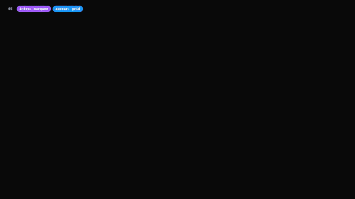
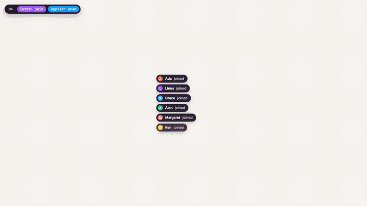

# CursorBuild

A scroll-in animation for React sites. When a section scrolls into view, a crew of live multiplayer cursors rebuilds it in front of the visitor, Figma style:
- boxes dragged out with a crosshair and a W × H badge
- text typed with an I-beam and caret
- pen-tool lines, rulers and red guides that text snaps to
- repeated cards ⌥-dragged off the first
- images swept on

Then the cursors leave and the real, clickable section is handed back.



This repo is a [Claude Code](https://claude.com/claude-code) skill, and the component inside it also works on its own.

## Examples

Our 5 examples, from the [OriginKit X](https://originkit-x-posts.vercel.app) studio. Each is a real section, filling the screen, with its own intro and its own appear. The cursors rebuild it as it scrolls in, then hand back the real section.

### 01 · `intro="logo"` + `appear="fade"`

The cursors orbit the site's logo, fan out and build; the canvas fades away over the real hero. This one uses `cursors={6}` for a calm build.


```tsx
<CursorBuild intro="logo" appear="fade" cursors={6}>
  <Hero />
</CursorBuild>
```

### 02 · `intro="prompt"` + `appear="wipe"`

A prompt bar types the request and Build is pressed. The crew fans out of it, each cursor saying what it's doing. The canvas wipes away top to bottom.


```tsx
<CursorBuild intro="prompt" prompt="Pricing section, dark, three plans, Studio highlighted" appear="wipe" chat>
  <Pricing />
</CursorBuild>
```

### 03 · `intro="burst"` + `appear="iris"`

A circle opens the canvas. Forty cursors knot around a pulsing dot, then explode outward and build; a growing hole reveals the real section.


```tsx
<CursorBuild intro="burst" appear="iris" cursors={40}>
  <Bento />
</CursorBuild>
```

### 04 · `intro="join"` + `appear="scan"`

"Ada joined", "Linus joined"… presence pills stack up as each named cursor arrives. The section is revealed behind a glowing scan line.



```tsx
<CursorBuild intro="join" appear="scan" labels>
  <Footer />
</CursorBuild>
```

### 05 · `intro="marquee"` + `appear="grid"`

A selection box grows over the section with a live W × H badge. A named team (Layout, Type, Image, QA…) builds it on a dotted design canvas, which fades before the hand-back.


```tsx
<CursorBuild intro="marquee" appear="grid" agents chat>
  <Features />
</CursorBuild>
```

The clips are sped up to match a normal browser: they were recorded headless, which renders slower. In the browser, a section takes about 10 to 12 seconds from scroll-in to hand-back.

## Use the component

Copy [`assets/CursorBuild.tsx`](assets/CursorBuild.tsx) into your project. It's one file and needs only React 18+. Then wrap a section:

```tsx
import CursorBuild from "@/components/CursorBuild";

<CursorBuild intro="burst" appear="iris" cursors={14} threshold={0.7}>
  <Pricing />
</CursorBuild>
```

| Prop | Default | |
|---|---|---|
| `intro` | `"logo"` | `logo` · `prompt` · `burst` · `join` · `marquee` |
| `appear` | `"fade"` | `fade` · `wipe` · `scan` · `iris` · `grid` |
| `cursors` | 18 | How many cursors; how many build at once and the finale scale with it |
| `maxCursors` | cursors × 48 ⁄ 18 | The most at once while building |
| `labels`, `chat`, `agents` | false | Name pills on the cursors, what each is doing, a named team |
| `prompt` | — | The request the `prompt` intro types |
| `speed` | 1 | 2 and 3 are fast |
| `threshold` | 0.35 | Share of the section on screen before it starts |
| `sound` | false | Synthesized clicks and notes (after the visitor's first click) |

Every prop is documented at the top of the file and in [`SKILL.md`](SKILL.md). [`assets/demo-cursor-build.tsx`](assets/demo-cursor-build.tsx) is an example page: five full-viewport sections, each with its own intro and appear.

## Install as a Claude Code skill

```bash
git clone https://github.com/sridhar-raj/cursor-build ~/.claude/skills/cursor-build
```

Then, in any project, ask Claude to "make the pricing section build itself with cursors".

## How it's made

`CursorBuild.tsx` is generated by [`scripts/build-cursor-build.py`](scripts/build-cursor-build.py). It copies the engine of the original `swarm.js` verbatim, then applies a list of named patches. The patches scope it to one element and add the intros, appears, labels and cursor count. Don't edit the generated file; edit the parts in `scripts/` and rebuild:

```bash
cd scripts && python3 build-cursor-build.py ../assets/CursorBuild.tsx
```

## Credit

The engine is **swarm-cursors** by Dhvanil Patel ([repo](https://github.com/DhvanilPatel/swarm-cursors)). It is a tribute to **Swarm** by Joel Califa ([site](https://califa.github.io/swarm-site/), [source](https://github.com/califa/swarm-site)), whose motion design it adapts: the cursor set, the flocking physics, the build choreography and the rulers. Used with permission. Keep this credit wherever the component ships.
